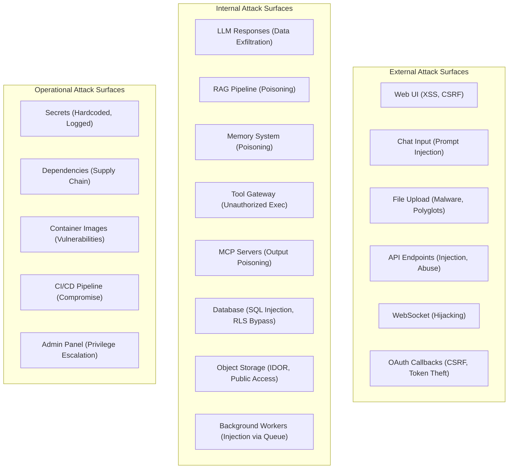
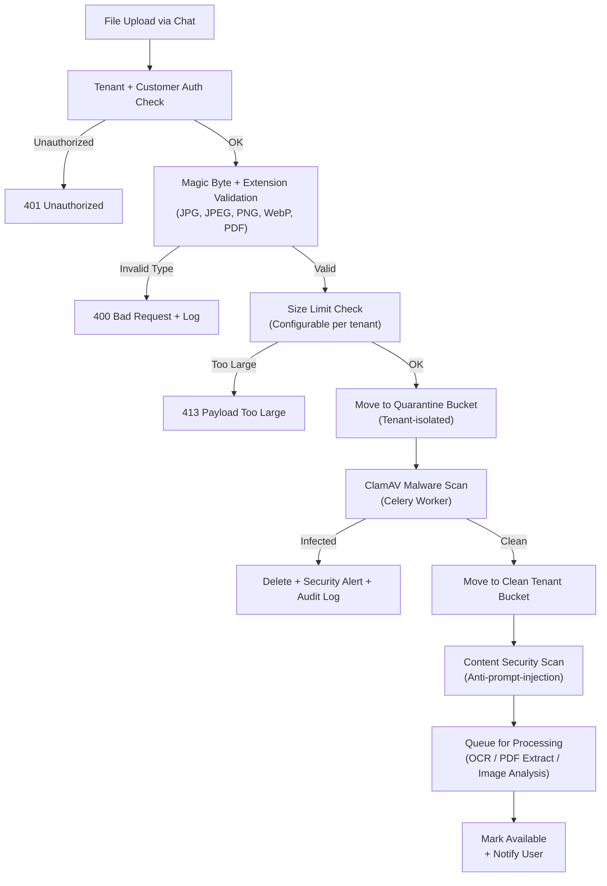

# SECURITY ASSESSMENT — ConversaIQ

**Date:** 2026-11-24  
**Status:** Pre-implementation Threat Model & Tooling Plan (Greenfield)  
**Reference:** Master Specification §7

---

> [!IMPORTANT]
> No security controls exist. This is a **forward-looking threat model**, not a scan report. No certifications or compliance claims are made.

---

## 1. Threat Model

### 1.1 Attack Surface Map



### 1.2 Detailed Threat Analysis

| # | Surface | Threats | Severity | Phase |
|---|---|---|---|---|
| T-01 | **Authentication** | Credential stuffing, session hijacking, token theft, replay attacks | Critical | P3 |
| T-02 | **Authorization** | Privilege escalation, IDOR, broken access control, role confusion | Critical | P3 |
| T-03 | **Multi-tenancy** | Cross-tenant data leakage, tenant ID spoofing, shared resource contamination | Critical | P3 |
| T-04 | **Chat Input** | Direct prompt injection, XSS, command injection via chat messages | High | P5 |
| T-05 | **File Upload** | Malware, path traversal, zip bombs, polyglot files, embedded scripts/macros | Critical | P6 |
| T-06 | **Uploaded Documents** | Indirect prompt injection via PDF/image content overriding system instructions | High | P6 |
| T-07 | **LLM Output** | Data exfiltration via crafted prompts, hallucinated PII, instruction leakage | High | P5 |
| T-08 | **RAG Pipeline** | Poisoned documents → corrupted embeddings → manipulated AI responses | High | P7 |
| T-09 | **Memory System** | Memory poisoning via adversarial interactions, unauthorized memory access | High | P8 |
| T-10 | **Tool Gateway** | Unauthorized tool invocation, sandbox escape, resource exhaustion | High | P12 |
| T-11 | **MCP Servers** | Output poisoning, SSRF via external tools, credential exposure | High | P12 |
| T-12 | **API** | Rate limiting bypass, mass data harvesting, parameter tampering | Medium | P2 |
| T-13 | **Secrets** | Hardcoded credentials, log leakage, env file exposure, git history exposure | Critical | P1 |
| T-14 | **Dependencies** | Supply chain attacks, vulnerable packages, typosquatting | High | P1+ |
| T-15 | **File Storage** | Insecure direct object references, public bucket access, missing auth on downloads | High | P6 |
| T-16 | **Google Sheets OAuth** | OAuth token theft, excessive permissions, unauthorized write access | Medium | P4 |
| T-17 | **WhatsApp/Email Feedback** | Link spoofing, delivery tracking exposure, rate limit bypass | Medium | P9 |
| T-18 | **Analytics Copilot** | AI-generated SQL injection, unauthorized data access via natural language | High | P11 |

### 1.3 STRIDE Analysis

| Category | Examples | Primary Mitigations |
|---|---|---|
| **Spoofing** | Forged JWT, tenant ID manipulation, OAuth CSRF | Keycloak-issued tokens, state parameters, server-side validation |
| **Tampering** | Modified chat history, poisoned embeddings, altered business data | Signed messages, immutable audit log, embedding integrity checks |
| **Repudiation** | Denied actions in chat/admin/tool execution | Comprehensive audit trail: tenant + user + action + timestamp |
| **Information Disclosure** | Cross-tenant leak, LLM data exfiltration, file exposure | RLS, tenant-scoped queries, output filtering, signed URLs |
| **Denial of Service** | LLM token bombing, file upload flooding, API abuse | Rate limiting, file size limits, token budgets, circuit breakers |
| **Elevation of Privilege** | Customer → admin, tool sandbox escape, SQL via Copilot | RBAC, least privilege, sandboxed execution, governed queries |

---

## 2. Security Tooling Assessment

### 2.1 Recommended Security Stack

| Tool | Purpose | Priority | License |
|---|---|---|---|
| **Semgrep** | Static analysis — Python + TypeScript security rules | Critical | Open Source / Commercial |
| **Bandit** | Python-specific security linting (SQL injection, hardcoded secrets, exec calls) | High | Open Source |
| **Gitleaks** | Secrets detection in git commits and history | Critical | Open Source |
| **Trivy** | Container image + dependency + IaC vulnerability scanning | High | Open Source |
| **OWASP ZAP** | Dynamic application security testing (DAST) | High | Open Source |
| **Checkov** | Infrastructure-as-code scanning (Dockerfile, docker-compose, K8s, Terraform) | Medium | Open Source |
| **Promptfoo** | LLM prompt evaluation, injection testing, red-teaming | High | Open Source |
| **Garak** | LLM vulnerability probing (jailbreaking, exfiltration, injection) | Medium | Open Source |
| **Playwright** | E2E security tests (auth flows, CSRF, XSS verification) | High | Open Source |
| **pip-audit** | Python dependency vulnerability scanning | High | Open Source |
| **npm audit** | Node.js dependency vulnerability scanning | High | Built-in |
| **Syft** | SBOM generation (Software Bill of Materials) | Medium | Open Source |
| **ClamAV** | File malware scanning (integrated into Document Pipeline) | Critical | Open Source |

### 2.2 Deployment Gate Matrix

| Tool | Local Dev (Pre-commit) | CI/CD (PR Check) | Staging (Nightly) | Production Release Gate |
|---|---|---|---|---|
| Semgrep | ✅ | ✅ | — | ✅ Blocking |
| Bandit | ✅ | ✅ | — | ✅ Blocking |
| Gitleaks | ✅ | ✅ | — | ✅ Blocking |
| Trivy | — | ✅ Image build | — | ✅ Blocking |
| OWASP ZAP | — | — | ✅ | ✅ Blocking (High/Critical) |
| Checkov | ✅ On IaC changes | ✅ | — | ✅ Blocking |
| Promptfoo | ✅ On prompt changes | ✅ | — | ✅ Blocking |
| Garak | — | — | ✅ Periodic | ✅ Major releases |
| Playwright (security) | ✅ On auth changes | ✅ | ✅ | ✅ Blocking |
| pip-audit | ✅ On dep changes | ✅ | — | ✅ Blocking |
| npm audit | ✅ On dep changes | ✅ | — | ✅ Blocking |
| Syft (SBOM) | — | ✅ Image build | — | ✅ Attached to release |
| ClamAV | — | — | ✅ (integration test) | ✅ Runtime |

---

## 3. AI-Specific Security Controls

### 3.1 Prompt Injection Defense (5 Layers)

```
Layer 1: INPUT VALIDATION
├── Reject known injection patterns (regex + ML classifier)
├── Sanitize special tokens and control characters
└── Length limits on user messages

Layer 2: SYSTEM PROMPT ISOLATION  
├── Separate system/user/tool message roles
├── Never include user content in system prompt
└── Organization instructions as structured context, not raw prompt

Layer 3: OUTPUT FILTERING
├── Scan LLM output before display
├── Redact potential PII leakage
├── Block instruction echoing
└── Validate tool call arguments before execution

Layer 4: TOOL APPROVAL GATE
├── Risk classification (LOW/MEDIUM/HIGH)
├── Human approval for HIGH-risk actions
├── Argument validation against Pydantic schemas
└── Execution sandboxing with timeouts

Layer 5: MONITORING & DETECTION
├── Log all LLM interactions (input/output/tools)
├── Anomaly detection on tool call patterns
├── Alert on suspected injection attempts
└── Periodic Promptfoo + Garak red-team runs
```

### 3.2 RAG Security (§4D, §7)

- Source document validation before embedding (file type, tenant ownership, content scan)
- Embedding integrity checksums per document version
- Tenant-scoped vector namespaces — no cross-tenant retrieval possible
- Retrieval result attribution — every AI answer cites source documents
- Stale document detection with freshness warnings
- Re-indexing validation after document updates

### 3.3 Memory Security (§4C, §7)

- Memory entries tagged with provenance (which conversation/event created them)
- Access control: only the owning tenant+customer can retrieve memories
- Expiration policies: working memory clears per session, episodic/semantic have configurable TTL
- Anti-poisoning: validate memory updates against conversation context
- Audit trail: all memory mutations logged

### 3.4 Tool Execution Security (§6, §7)

- Whitelist-only tool registration in Tool Gateway
- Input validation via Pydantic schemas before every execution
- Execution timeout and resource limits (CPU, memory, network)
- Output sanitization before return to LLM context
- Risk classification: LOW (read), MEDIUM (write), HIGH (destructive/financial)
- HIGH-risk actions require human approval
- Complete audit log: who, what tool, what input, what output, when
- MCP server output treated as untrusted — validated before use

### 3.5 Analytics Copilot Security (§4I)

- Read-only analytical service layer — no raw SQL access
- Pre-approved query templates with parameter binding
- Tenant-scoped data access — Copilot cannot cross tenant boundaries
- Result set size limits
- Query timeout and resource caps
- All Copilot queries logged for audit

---

## 4. File Upload Security Pipeline (§4B, §7)



Security invariants:
- All uploads treated as hostile until proven clean
- No execution of embedded scripts or macros
- Document/image content cannot override system instructions
- Signed, expiring download URLs — no direct bucket access
- Tenant+customer authorization checked on every download
- Retention policies enforced: auto-delete after configured period

---

## 5. Network and Infrastructure Security

| Control | Description | Phase |
|---|---|---|
| HTTPS everywhere | TLS 1.2+ on all endpoints | P1 (dev self-signed), P14 (prod CA) |
| Security headers | HSTS, CSP, X-Frame-Options, X-Content-Type-Options | P1 |
| CORS configuration | Allowlist frontend origin only | P2 |
| Rate limiting | Per-tenant, per-endpoint, per-IP | P2 |
| Container hardening | Non-root user, read-only filesystem, resource limits | P14 |
| Network segmentation | Backend not directly internet-accessible (via ALB) | P14 |
| Secret injection | Environment variables or secrets manager — never in code | P1 |
| Encrypted at rest | Database and object storage encryption | P14 |
| Encrypted in transit | TLS between all services | P14 |
| Audit logging | Immutable, tenant-scoped, exportable | P3+ |

---

## 6. Compliance Posture

> [!CAUTION]
> This assessment does **not** claim compliance with any standard. The security controls recommended are **foundations** that would support a future compliance program.

| Standard | Relevance | Current State | Architecture Support |
|---|---|---|---|
| OWASP Top 10 (Web) | High | Not addressed (greenfield) | Architecture designed to address all 10 |
| OWASP Top 10 (LLM) | High | Not addressed (greenfield) | AI security controls designed per OWASP LLM guidance |
| GDPR | Medium–High | Not addressed | Tenant isolation, retention policies, deletion, consent planned |
| SOC 2 | Medium | Not addressed | Audit logging, access control, monitoring planned |
| NIST CSF | Medium | Not addressed | Architecture aligns with Identify/Protect/Detect/Respond/Recover |

---

## 7. Current Security Posture

| Aspect | Status |
|---|---|
| Security controls implemented | **None** (greenfield) |
| Security scans executed | **None** |
| Vulnerabilities found | **N/A** |
| Scan results available | **N/A** |
| Verification confidence | **VERIFIED** (confirmed nothing exists to scan) |
